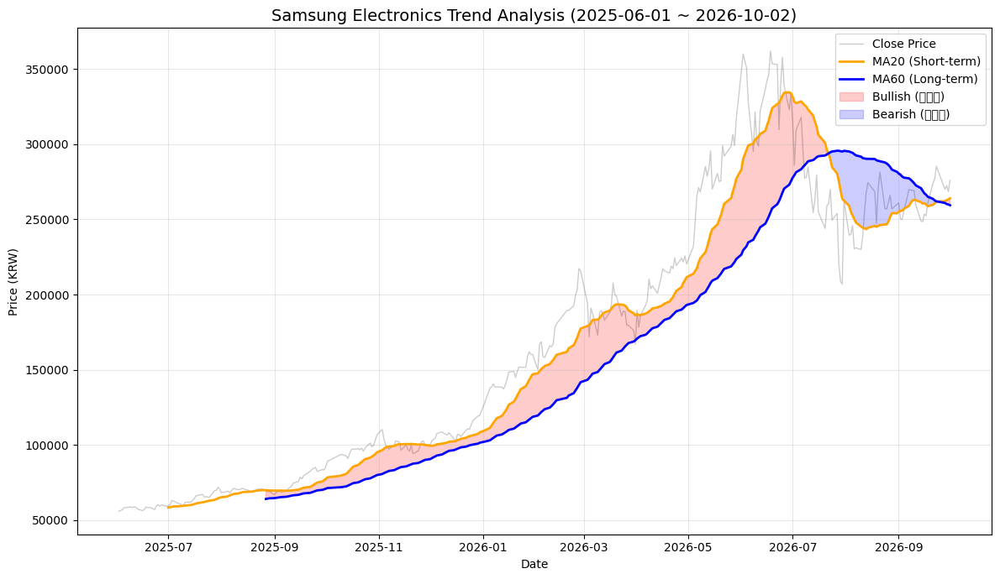

# 📈 삼성전자 주가 시계열 분석 및 기술적  지표 신뢰도 검증
 ## **분석 개요**
 
분석 대상: 삼성전자 (005930.KS)

데이터 출처: Yahoo Finance (2025.06 ~ 2026.10, 342 거래일)

데이터 포인트: 약 350개 이상의 일일 주가 데이터 포인트 사용

### **질문 1.  현재 매수/매도 적기인가?**

 
 
**[그래프 1] 삼성전자 추세분석**

1. **정배열(Red Zone)**: 20일선이 60일선 위에 있는 구간

      <해석> 이때는 시장이 상승세이므로 **매수 및 보유(Hold)**가 유리함. 

 2.  **역배열(Blue Zone)**: 20일선이 60일선 아래에 있는 구간.

      <해석> 이때는 하락세이므로 **관망 또는 매도**가 유리함. 

 3.  **인사이트**: 그래프의 가장 오른쪽 끝(2026년 10월 시점)이  빨간색 구간므로  현재 삼성전자는 상승 추 세에 있으므로 긍정적이다

 
 
**[그래프 1-확대본] 질문 1: 현재 시점 추세 정밀 분석**

 
 
### **질문 2.  거래량 급증한 시기와 그 배경은 무엇인가? (사회/정치 이슈나 이벤트)**

 
 
**[그래프 2] 거래량 급증 구간**

1. **빨간색 막대의 의미**: 거래량이 20일 평균 대비 1.5배 이상 급증한 지점은 시장의 관심이 집중된 시기
2. **뉴스 연계**: "특히 **가장 높은 막대 날짜**에는 삼성전자의 대형 수주나 실적 발표와 같은 중요한 이벤트가 있었을 가능성이 매우 높으므로, 해당 시점의 뉴스를 추적하여 주가 변동의 원인을 파악해야 함. 
3. **거래량과 추세**: 거래량이 터지면서 주가가 같이 올랐다면 강력한 상승 신호로, 거래량이 터지면서 주가가 빠졌다면 강력한 하락 신호로 해석할 수 있음. 

 
 
**[그래프 2-1] 거래량 급증 구간의 매수/매도 성격 판별 분석**

1. **빨간색 막대(매수세 폭발)**:
    - 대형 호재가 터지면서 많은 투자자가 공격적으로 주식을 사들임. 향후 주가 상승의 강력한 지지선이 될 가능성이 큼.
2. **파란색 막대(매도세 폭발)**:
    - 악재로 인해 패닉 셀(Panic Sell)이 발생했을 가능성이 큼. 거래량을 동반한 하락은 하락 추세의 시작일 수 있으므로 주의가 필요함.

★ 가장 강력한 패닉셀 발생일: 2026-03-04
당일 하락률: -11.74%

- **패닉셀의 의미:** 특정 악재로 인해 투자자들이 공포(Panic)를 느끼고 한꺼번에 물량을 던졌음을 의미함.
- **투자 전략:** 일반적으로 패닉셀 이후에는 과매도에 따른 기술적 반등이 나오는 경우가 많으므로, 해당 날짜 이후의 주가 흐름을 주시할 필요가 있음.

 
 
**<거래량 급증시의 사회적 이슈/ 이벤트>**
 

|              시점 |            그래프 |    기사로 확인되는 주요 사건 |                        해석 |
| --- | --- | --- | --- |
| **2025년 7월 말** | 매수 증가 🔴 | 삼성전자가 **테슬라와 165억 달러 규모 반도체 공급계약**을 체결. 적자였던 파운드리 사업의 대형 고객 확보라는 점이 부각됨. ([Reuters](https://www.reuters.com/business/samsung-elec-signs-chip-supply-deal-with-tesla-sources-say-2025-07-28/?utm_source=chatgpt.com)) | 대형 수주에 따른 **파운드리 실적 회복 기대**가 거래량 증가와 매수세를 자극 |
| **2025년 10월 2일 전후** | 강한 매수 🔴 | 삼성전자·SK하이닉스가 **OpenAI의 Stargate 프로젝트와 반도체 공급 협력** 발표. 당일 삼성전자 +4.7%, SK하이닉스 +12%, 코스피도 3% 이상 상승. ([Reuters](https://www.reuters.com/world/asia-pacific/samsung-sk-hynix-shares-rally-openai-partnerships-2025-10-02/?utm_source=chatgpt.com)) | AI 데이터센터용 메모리 수요 확대 기대가 직접적인 매수 촉매 |
| **2025년 10월 중순** | 매수 증가 🔴 | 삼성전자 3분기 영업이익 전망이 시장 예상치를 웃돌고, 범용 DRAM·NAND 가격 상승과 서버 수요 개선이 확인됨. ([Reuters](https://www.reuters.com/world/asia-pacific/samsung-elec-estimates-32-rise-q3-operating-profit-beating-expectations-2025-10-13/?utm_source=chatgpt.com)) | **실적 서프라이즈 + 메모리 가격 상승**에 대한 재평가 |
| **2025년 11월 중하순** | 매도 증가 🔵 | AI 관련주의 고평가·버블 우려가 커지면서 한국 반도체주 동반 하락. 11월 18일 삼성전자 -2.78%, SK하이닉스 -5.94%, 외국인 순매도도 확대됨. ([Indo Premier](https://www.indopremier.com/ipotnews/newsDetail.php?group_news=IPOTNEWS&halaman=1&jdl=South_Korean_shares_fall_more_than_3%25_as_chipmakers_drop_on_AI_worries&name=&news_date=&news_id=208546&q=korean+shares%2C+kosdaq%2C+kospi%2C&search=y_general&taging_subtype=Emerging+Market&utm_source=chatgpt.com)) | 삼성전자 개별 악재라기보다 **글로벌 AI주 밸류에이션 부담과 외국인 위험회피** |
| **2026년 3월 3~4일** | **최대 매도 스파이크 🔵** | 미국·이스라엘의 이란 공격 이후 전쟁 확대 우려. 3월 3일 코스피 -7.24%, 삼성전자 장중 약 -5% 수준 하락. 다음 날 코스피는 장중 10% 이상 급락하며 서킷브레이커 발동. 한국은 중동산 원유 의존도가 높아 유가 충격에 특히 민감했음. ([연합뉴스](https://en.yna.co.kr/view/AEN20260303003100320?utm_source=chatgpt.com)) | **중동전쟁 → 국제유가 급등 → 원화 약세·한국 경제 충격 우려 → 외국인 및 기관 대규모 매도**. 이것이 3월 패닉셀의 핵심 |
| **2026년 3월 18일 전후** | 노조 이벤트 | 삼성전자 노조원 투표에서 **93%가 파업 승인**, 5월 21일부터 18일간 파업 계획을 예고. ([Investing.com](https://www.investing.com/news/stock-market-news/samsungs-unionised-workers-in-south-korea-approve-strike-plan-4567616?utm_source=chatgpt.com)) | 노조 이슈는 실제 존재했지만 **그래프의 3월 초 최대 거래량 폭증과 시점이 다름**. 3월 패닉셀의 직접 원인으로 쓰면 부정확 |
| **2026년 5월 6일 전후** | 매우 강한 매수 🔴 | 글로벌 AI·반도체 랠리 속 삼성전자 **하루 14.4% 상승**, SK하이닉스 +10.6%. 삼성전자 시가총액이 1조 달러를 넘어섬. ([Reuters](https://www.reuters.com/world/asia-pacific/south-koreas-kospi-share-index-tops-7000-first-time-2026-05-06/?utm_source=chatgpt.com)) | AI 투자 확대와 반도체 수요·실적 기대가 동시에 반영된 **대규모 추세 매수** |
| **2026년 7월 7~8일** | 강한 매도 🔵 | 삼성전자가 2분기 영업이익 19배 증가를 발표했지만 주가는 급락. 시장은 **AI 인프라 투자 지속성, 메모리 가격 상승률 둔화, 실적 정점 가능성**을 우려. 7월 8일 삼성전자 장중 -7.6%. ([Investing.com](https://www.investing.com/news/stock-market-news/samsung-flags-19fold-jump-in-profit-but-shares-slump-on-jitters-ai-boom-may-stall-4777937?utm_source=chatgpt.com)) | 여기서야 비로소 **‘메모리 가격 둔화·실적 피크아웃’ 논리가 주요 매도 사유로 확인됨** |
| **2026년 7월 28~29일** | **대형 매도 스파이크 🔵** | 삼성전자 7월 28일 약 **-13~14%**, SK하이닉스 -14.7%. 중국 CXMT 상장·중국 반도체 장비 기술 발전, AI 인프라 투자 지속성 의문, 높은 밸류에이션이 동시에 부각. 다음 날에는 레버리지 ETF의 강제청산까지 겹침. ([Reuters](https://www.reuters.com/world/china/samsung-sk-hynix-slide-amid-nvidia-financing-worries-china-competition-2026-07-28/?utm_source=chatgpt.com)) | **중국 경쟁 심화 + AI 기대 약화 + 레버리지 포지션 청산**이 서로 증폭시킨 패닉성 매도 |

 
 
**[그래프 2-2] 거래량 급증 구간의 주가 (종가)**

---

**결론**

- **진짜 상승:** 2025년 하반기처럼 주가 상승 시 **빨간 막대**가 동반될 때.
- **가짜 상승(위험):** 2026년 5월 이후처럼 주가는 반등하려 하지만 **거래량이 줄어들거나 파란 막대가 더 클 때.**
  

### **질문 3. 골든/데드크로스의 신뢰도를 어떻게 검증하고 가짜 신호를 판별할 것인가?**

**( 즉, 골든 크로스는 무조건 매수 신호이고, 데드 크로스는 무조건 매도 신호인가?)**

**<용어 정의>**

**1. 골든크로스 (Golden Cross)**

- **정의:** 단기 이동평균선(예: 20일선)이 장기 이동평균선(예: 60일선)을 아래에서 위로 강하게 돌파하는 현상
- **의미:** 최근 주가의 상승 탄력이 장기 추세보다 강해졌다는 뜻이며, 시장에서는 이를 **강력한 매수 신호** 또는 **상승 추세로의 전환**을 의미

**2. 데드크로스 (Death Cross)**

- **정의:** 단기 이동평균선이 장기 이동평균선을 위에서 아래로 하향 돌파하는 현상
- **의미:** 주가 상승세가 꺾이고 하락 압력이 강해졌음을 나타내며, **강력한 매도 신호** 또는 **하락 추세의 시작**으로 간주됨.

**3. RSI (Relative Strength Index, 상대강도지수)**

- **정의:** 일정 기간 주가의 상승폭과 하락폭을 비교해 현재 주가의 과열 또는 침체 여부를 0~100 사이의 수치로 나타내는 보조지표
- **기준:**
    - **70 이상:** 과매수(Overbought) 구간으로 주가가 너무 많이 올라 곧 조정을 받을 가능성이 큼.
    - **30 이하:** 과매도(Oversold) 구간으로 주가가 너무 많이 내려 곧 반등할 가능성이 큼.
- **의미:** 추세의 강도를 측정해 이평선 교차 신호의 신뢰도를 보완함.

**4. 불트랩 (Bull Trap, 상승 함정)**

- **정의:** 주가가 저항선을 돌파하거나 골든크로스가 발생해 상승할 것처럼 보였지만, 매수세가 이어지지 않아 다시 급락하는 현상
- **특징:** 가짜 돌파 후 이전 저점보다 더 깊이 하락하는 경우가 많아 투자자에게 큰 손실을 안길 수 있음.

**5. 베어트랩 (Bear Trap, 하락 함정)**

- **정의:** 주가가 지지선을 하향 돌파하거나 데드크로스가 발생해 본격적인 하락장이 시작된 것처럼 보였지만, 곧 강하게 반등하는 현상
- **특징:** 공포심을 유발해 개인 투자자의 물량을 받아낸 뒤 주가를 끌어올리는 세력의 움직임에서 자주 나타남.

 
 
**[그래프 3] 추세 추종 지표의 한계 극복: 이평선, RSI, 거래량을 활용한 다각적 시장 진단**

 

**1. 고점 부근의 과열 징후 (2026년 3월 ~ 5월)**

- **현상:** 주가가 최고점(약 36만 원)을 향해 가파르게 상승할 때, **RSI 지표가 80을 상회**하는 과매수 신호가 반복적으로 나타났으며, 하단 **거래량(Volume)이 역대 최대치**로 폭발함.
- **해석:** 주가 상승의 에너지가 정점에 달한 '오버슈팅' 구간. RSI의 극심한 과열과 거래량 폭발은 스마트 머니의 수익 실현 물량이 나오고 있음을 암시하며, 추세 전환이 임박했음을 알리는 강력한 **선행 경고 신호**

**2. 하락 추세 확정과 신호의 후행성 (2026년 7월 말)**

- **현상:** 주가가 이미 고점 대비 약 30% 이상 급락하여 25만 원 선에 도달한 시점에 **데드크로스(▼)** 가 발생함.
- **해석:** 이동평균선 교차 신호의 전형적인 **후행성(Lagging)** 을 보여줌. 주가는 이미 하락세에 접어들었으나, 이평선은 뒤늦게 하락 추세를 확정 지음. 이는 이평선만 보고 대응할 경우 매도 타이밍이 늦어질 수 있음을 의미하며, RSI와 같은 보조지표를 병행해야 하는 이유를 뒷받침 함.

**3. 과매도 구간에서의 바닥 확인 (2026년 8월 ~ 9월)**

- **현상:** 데드크로스 이후 주가가 추가 하락하는 과정에서 **RSI가 30 부근(과매도 영역)** 까지 하락한 뒤 점진적으로 저점을 높임.
- **해석:** 주가의 하락 압력이 진정되고 매도세가 진정되는 **바닥 다지기** 국면. RSI가 과매도 구간에서 탈출하기 시작하는 것은 하락 에너지가 소진되었음을 뜻하며, 기술적 반등 혹은 추세 전환의 준비 단계로 해석할 수 있음.

**4. 새로운 상승 추세의 시작 (2026년 10월 현재)**

- **현상:** 차트의 가장 우측 끝단에서 단기 이평선(MA20)이 장기 이평선(MA60)을 상향 돌파하는 **골든크로스(▲)** 가 발생함.
- **해석:** 장기간 이어진 하락 추세를 끊고 **새로운 상승 추세로 전환**되었음을 알리는 신호. RSI가 중립선(50)을 회복하며 우상향하고 있고, 주가가 이평선 위로 올라탄 점을 고려할 때, 단기적으로 긍정적인 주가 흐름이 이어질 가능성이 높은 것으로 해석됨.

#### 이 그래프의 한계점:

- **이유:** 단기 이평선(20일/60일) 교차신호만으로는 '지금이 큰 하락장 속의 일시적 반등인지' 알 수 없다는 점(맹점)과 신호가 늦게 나타나는 후행성의 문제점이 있음.
- **한계점 1. 후행성 문제 :** 2026년 7월 데드크로스는 주가 폭락이 상당 부분 진행된 후 발생하여 실질적인 리스크 관리 타이밍을 놓치게 만듦.
- **한계점 2  장기 추세 필터링 부재의 문제:** 현재(10월) 발생한 골든크로스가 장기 이평선(120/200일) 아래에서 발생한 '역배열 내 반등'인지 확인이 불가능하여, 성급한 매수 결정의 위험이 있음.
- **결론:** 따라서 단기 이평선 신호의 신뢰도를 높이기 위해서는 **장기 이평선을 통한 전체 추세 확인**과 **RSI/거래량을 통한 과열 상태 점검**이 반드시 병행되어야 함.

 
 
**[그래프 4]**   **후행성 극복과 장기 추세 필터링: 120/200일 이평선을 활용🎢**- 결측치 보완

### 📈 한계점을 보완한 결론📈

**1. 주요 현상 (What we see)**

- **대세 상승기 (2025.06 ~ 2026.07):** 주가가 약 5만 원대에서 시작해 최고 35만 원대까지 치솟는 강력한 우상향 흐름을 보임. 모든 이동평균선이 정배열(단기 > 중기 > 장기) 상태
- **데드크로스 발생 (2026.07 말):** 주가가 급락하며 노란색 20일선이 보라색 60일선을 뚫고 내려가는 **데드크로스**(파란 역삼각형)가 발생
- **장기 이평선의 지지 (2026.08 ~ 09):** 주가가 하락했지만, 파란색 점선(120일선) 부근에서 하락을 멈추고 횡보하며 바닥을 다지는 모습이 보임.
- **골든크로스 발생 (2026.10 초):** 최근 시점에서 20일선이 다시 120일선을 상향 돌파하는 **골든크로스**(빨간 삼각형)가 발생하며 반등의 신호를 보내고 있음.

**2. 시장 해석 (Interpretation)**

- **단기 과열과 조정:** 2026년 7월의 급락은 1년 넘게 이어진 상승에 대한 피로감과 차익 실현 매물이 쏟아진 결과로 해석됨. 이때 발생한 **데드크로스는 아주 정확한 '매도/주의' 신호**
- **120일선의 신뢰도:** 주가가 급락할 때 120일선(파란 점선)이 강력한 지지선 역할을 함. 이는 시장 참여자들이 "이 정도 가격이면 충분히 싸다"라고 판단하는 기준선이 120일선이었음을 의미.
- **추세의 건전성:** 가장 아래에 있는 **빨간색 200일선**이 꺾이지 않고 계속 우상향하고 있고, 이는 단기적으로는 주가가 흔들렸지만, **전체적인 장기 상승 추세는 여전히 살아있다**는 것을 증명하는 것.

**3. 투자 인사이트 (Insight)**

- **신호 기반 매매의 유효성:** 7월 데드크로스 때 비중을 줄였다면, 이후 발생한 약 10만 원 폭의 하락 손실을 피할 수 있었을 것. 이평선 교차 신호가 삼성전자 같은 대형주에서 얼마나 강력한지 보여주는 사례.
- **현재 시점의 전략 (골든크로스):** 그래프 맨 오른쪽 끝의 빨간 삼각형(골든크로스)은 **'2차 상승의 서막**'일 가능성이 높다고 판단되는데, 이는 장기 추세(200일선)가 살아있는 상태에서 단기 이평선이 고개를 들고 있기 때문임.
- **거래량과의 결합:** 하단 거래량을 보면, 주가가 바닥을 다질 때 거래량이 줄어들다가 반등 시점에 다시 조금씩 살아나고 있고, 이는 매도세가 진정되고 새로운 매수 주체가 유입되고 있다는 긍정적인 신호임.

---

**결론 및 한계점**

**[결론]**
본 분석을 통해 삼성전자 주가는 외부 정치/경제 이슈에 민감하게 반응하며, 특히 거래량과 RSI 지표를 결합했을 때 기술적 지표의 신뢰도가 극대화됨을 확인함. 장기 이평선은 시장의 중심을 잡는 필터로서 매우 중요한 역할을 함.

**[한계점]**
데이터 기간: 약 1년 반의 데이터로는 10년 단위의 초장기 사이클을 완벽히 예측하기 어려움.
변수의 돌발성: 전쟁과 같은 비경제적 변수는 기술적 분석의 예측 범위를 일시적으로 벗어남.

 ---
 
**[이번 미션을 통해 배운 점]**

#### 1. 시계열의 3요소 적용 (Trend, Seasonality, Noise)

*   **트렌드 (Trend - 추세):** 
    *   **차트 적용:** 가장 굵은 **빨간색 선(MA200)** - 주가가 위아래로 흔들려도 이 선은 꾸준히 우상향: 이것이 삼성전자의 **장기적인 성장 추세**.
    *   **왜 분석하나?**: 현재 주가가 일시적으로 떨어졌어도 "아직 장기적인 상승 흐름(트렌드)은 깨지지 않았다"는 것을 판단하기 위해서.

*   **계절성 (Seasonality - 주기성):**
    *   **차트 적용:** 차트 중간에 분홍색(Bullish)과 하늘색(Bearish) 영역이 반복됨.- **정배열/역배열**: 주가는 직선으로 가지 않고 상승과 조정을 반복하는 **사이클(Cycle)**을 가짐.
    *   **왜 분석하나?**: 삼성전자의 반도체 업황이나 배당 시즌 등 특정 주기에 따른 반복적인 흐름을 파악해 매수/매도 타이밍을 잡기 위해서.

*   **노이즈 (Noise - 불규칙 변동):**
    *   **차트 적용:** 배경에 흐릿하게 그려진 **회색 실선(Close Price)**. 매일매일의 뉴스나 심리에 따라 뾰족뾰족하게 튀어오르거나 떨어지는 값들.
    *   **왜 분석하나?**: 노이즈는 예측이 불가능하므로, 이 노이즈에 속지 않기 위해 '이동평균'이라는 도구를 사용해 선을 매끄럽게 만드는 것.

---

#### 2. 시계열 분석 기법 (왜, 어떻게 적용했나?)

*   **이동평균 (Moving Average, MA):**
    *   **어떻게?**: 20일(단기), 60일(중기), 120일/200일(장기) 평균값을 계산해 선으로 연결
    *   **왜?**: **'노이즈 제거'**가 목적. 회색 선(현재가)만 보면 혼란스럽지만, 이동평균선을 보면 "지금은 단기적으로는 오르지만(MA20), 중기적으로는 아직 저항을 받고 있다(MA120)"는 **흐름의 위계**를 파악할 수 있음.

*   **변화율 및 교차 분석 (Cross Analysis):**
    *   **어떻게?**: 골든크로스(빨간 삼각형)와 데드크로스(파란 역삼각형)를 찾기.
    *   **왜?**: 시계열 데이터에서 **'추세의 전환점'** 을 찾기 위해서. 단기 평균선이 장기 평균선을 뚫는다는 것은, 최근의 데이터 힘(변화율)이 과거의 평균적인 힘보다 강해졌다는 것을 의미하므로 매수 신호로 해석.

---

#### 🌟 삼성전자 주가 시계열 분석에 대입해보기

"최근  골든크로스가 났지만(단기적 변화율 상승), 120일선 아래에 있음(중기적 트렌드 저항)"
1.  **노이즈**를 이겨내고 **단기 트렌드**가 고개를 들었지만,
2.  **중기 트렌드(120일선)** 라는 강력한 벽이 아직 위에 버티고 있으며,
3.  이 벽을 넘어야만 **장기 트렌드(200일선)** 와 함께 본격적인 상승 궤도에 오른다는 것!

**시계열 분석의 핵심:** "나무(노이즈)를 보지 말고 숲(트렌드)을 보는 것"👏

